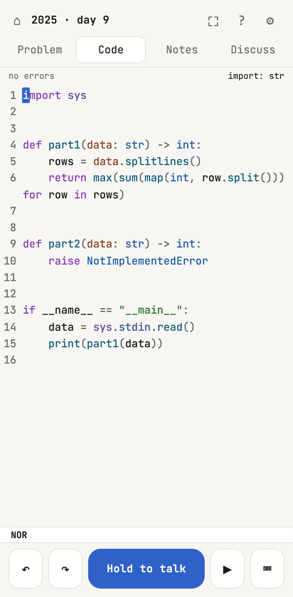
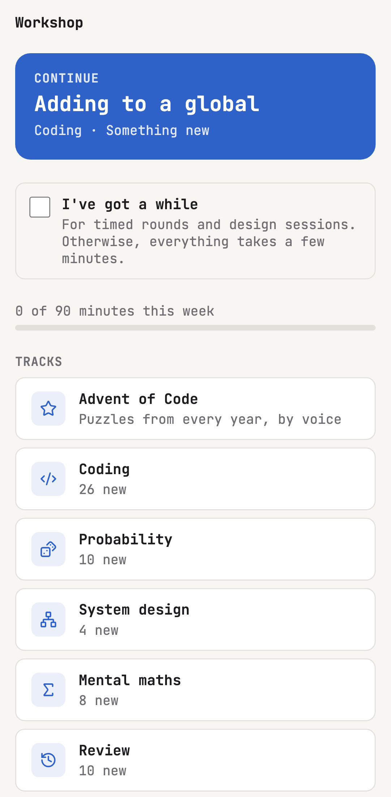
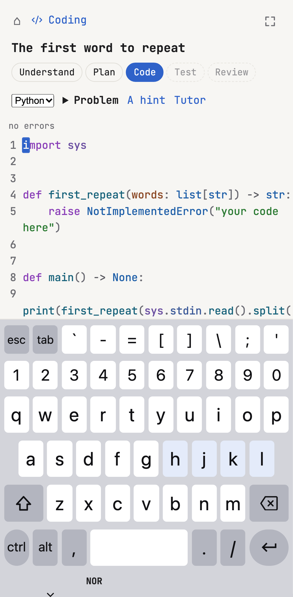
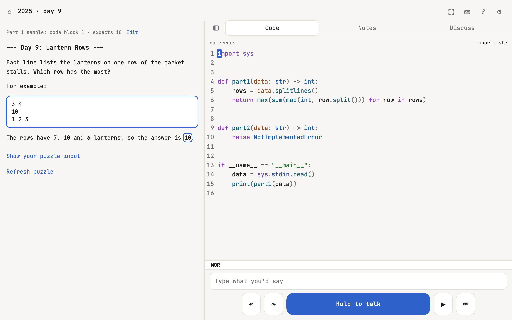

<h1 align="center">Workshop</h1>

<p align="center">
  A learning and coding platform built for your phone, that works great on desktop too.<br>
  Solve Advent of Code, sharpen your algorithms, and practise anything you like from packs of your own.
</p>

<p align="center">
  <picture>
    <source media="(prefers-color-scheme: dark)" srcset="docs/screenshots/advent-of-code-dark.png">
    
  </picture>
  &nbsp;
  <picture>
    <source media="(prefers-color-scheme: dark)" srcset="docs/screenshots/home-dark.png">
    
  </picture>
  &nbsp;
  <picture>
    <source media="(prefers-color-scheme: dark)" srcset="docs/screenshots/coding-dark.png">
    
  </picture>
</p>

## What's inside

- Advent of Code: every year's puzzles in your own language, with its language server, running on the sample before you submit.
- Coding: algorithm problems solved a step at a time, checked against hidden tests and a brute force, with a tutor that won't spoil the answer, plus code to read and small codebases to debug, review and refactor.
- Practice: cards, mental maths and probability that come back just before you'd forget them, even offline.
- Your own packs: anything you want to learn, as a folder of Markdown files, with an author that writes new items for what you find hardest.
- A real editor: Helix's keybindings, tree-sitter highlighting and a keyboard built for code on your phone, or dictate code instead.

<p align="center">
  <picture>
    <source media="(prefers-color-scheme: dark)" srcset="docs/screenshots/desktop-dark.png">
    
  </picture>
</p>

## Getting started

You'll need the [Claude Code](https://claude.com/claude-code), [Codex](https://developers.openai.com/codex) or [Antigravity](https://antigravity.google) CLI, logged in: Workshop uses your existing subscription for its tutors, grader and dictation.

```sh
brew install thomasschafer/tap/workshop
workshop
```

Open the link it prints. A short setup in the app takes it from there, and `workshop doctor` checks everything else, with fixes for anything missing. Without Homebrew, use the [install script or a binary](docs/setup.md#installing-and-starting).

To use it on your phone, install [Tailscale](https://tailscale.com) on your computer and phone, then start Workshop once with `workshop serve --tailscale` and scan the QR code. After that, `workshop` alone prints the phone link too.

## Documentation

- [Setting up](docs/setup.md): requirements, installing, and your phone
- [Learning in Workshop](docs/learning.md): the tracks, practice, and how you're graded
- [Packs](docs/packs.md) and [the author](docs/author.md): writing your own things to learn
- [Dictation](docs/dictation.md): editing code by voice
- [Configuration](docs/configuration.md): the config file and the editor
- [Security](docs/security.md): what the models can and can't do
- [Contributing](CONTRIBUTING.md): building, testing, and adding a language

## Licence

Dual-licensed under [MIT](LICENSE-MIT) or [Apache-2.0](LICENSE-APACHE), at your option.

The track icons in `frontend/src/tracks/icons.tsx` are from [Lucide](https://lucide.dev), under the ISC licence, whose notice is at the top of that file. Most of `frontend/src/helix`, the Helix keybindings, is ported from [Helix](https://github.com/helix-editor/helix); the ported files are under the [Mozilla Public License 2.0](https://mozilla.org/MPL/2.0/), as Helix is, and each says so at its top.

Workshop is unofficial and isn't affiliated with Advent of Code.
