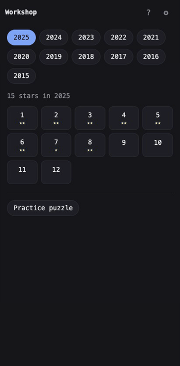

# Workshop

Solve [Advent of Code](https://adventofcode.com) puzzles by voice, from your phone.

Workshop runs on a server you control, such as your laptop, a desktop or a VPS, and you open it on your phone. The phone shows the puzzle and your code; you hold a button and say the code you want, roughly as you'd type it, and a model turns what you said into a precise edit. It's built for working one-handed, away from a desk.

<p align="center">
  
</p>

Workshop is voice editing, not code generation. "Write a function to sort a list" won't do anything. "Function solve from String to Int", then "solve equals lines", "before that map read dot" and "before that sum dot" gives you `solve = sum . map read . lines`. If Workshop isn't sure what you meant, it makes no edit and tells you why.

Workshop is unofficial and isn't affiliated with Advent of Code.

## What you get

- Puzzle and code side by side, in tabs, with big controls in the thumb zone.
- Edits relative to the cursor: tap to place it, then "before that", "wrap that in parens", and so on. Speech-recognition mistakes like "fold are" for `foldr` are fixed from context.
- Instant voice commands that don't need the model: "undo", "run the sample", "go to line 12", "next error", "snippet starter".
- Inline errors and types from your language server, when you have one.
- Run on the sample, run on your input, and submit, with a check against the sample's expected answer first.
- Discuss mode: a coach that can see the puzzle and your code, won't edit anything, and won't give the answer away unless you ask.
- Packages: a standard set for Haskell, and a one-tap install when an error says a module is missing. The list is a file in your solutions repo, so you can edit it by hand too.
- A helpers module that every solution can import, for the parsing and grid code that comes up again and again. It starts with a few helpers, and the language server knows where it is.
- Notes, snippets, and a commit-and-push button for your solutions repo.
- Colours follow your system's light or dark mode, and can use any [Ghostty](https://ghostty.org) theme, matching your terminal if you like, or a base16 theme file placed in Workshop's `themes` folder.
- Everything is saved as you go, so you can put the phone down and pick up where you left off, on the phone or at your desk.

## Requirements

- A model CLI that you're logged in to, used through your existing subscription: [Claude Code](https://claude.com/claude-code) or [Codex](https://developers.openai.com/codex). Workshop sets itself up for whichever you have.
- The toolchain for your language. Haskell and Python are built in: GHC and cabal with haskell-language-server, or Python 3 with pyright. The language server is optional and adds error underlines and types. Other languages can be added in your config.
- Your Advent of Code session cookie.
- A way to reach the server from your phone over HTTPS, which browsers require for the microphone. [Tailscale](https://tailscale.com) works well.

## Getting started

Download a binary from the [releases page](https://github.com/thomasschafer/workshop/releases) and put it somewhere on your PATH. On macOS, a binary downloaded in a browser is blocked until you allow it, either in System Settings, Privacy & Security, or with `xattr -d com.apple.quarantine workshop`. Then:

```sh
workshop doctor   # check your setup, with fixes for anything missing
workshop          # start the server and print the link to open
```

To use it from your phone over Tailscale, start it with:

```sh
workshop serve --tailscale
```

This runs `tailscale serve` for you, which gives Workshop an HTTPS address on your tailnet, and prints a link and QR code to open on your phone. The token in the link is then remembered by your phone's browser. Keep the server awake while you're out; on a Mac, for example, with `caffeinate -i`.

The first time you open Workshop, a short setup walks you through choosing your language and model, logging in to Advent of Code with your session cookie, and opening Workshop on your phone. You can run it again from Settings. If you'd rather not paste the cookie into the app, save it to the `aoc-session` file in Workshop's config directory (`workshop doctor` shows where), or set `AOC_SESSION`.

To try Workshop before logging in, or outside December, open the practice puzzle from the bottom of the puzzle list. It's made up for Workshop and works like a real puzzle, including submitting answers, which it checks itself.

## Configuration

Workshop writes a commented config file on first run; `workshop doctor` shows where it is. The defaults:

```toml
[server]
bind = "127.0.0.1:7878"

[solutions]
dir = "~/aoc"          # a git repo, created on first use
language = "haskell"   # or "python"

[models.edit]
provider = "claude"    # or "codex"
model = "haiku"        # always the latest; for Codex, a family such as "luna"

[models.discuss]
provider = "claude"
models = ["sonnet", "opus", "fable"]    # for Codex, ["sol", "astra"]

[[snippets]]
name = "parse ints"
body = "map read . lines"
```

You can switch between Claude Code and Codex, and between models, in the app under Settings, Models. After each edit, the model that made it and how long it took are shown, which makes comparing them easy. To check models against the same set of example utterances, use `workshop eval --model codex:luna`, for example.

Your program reads the puzzle input on stdin and prints the part 1 answer on the first line and the part 2 answer on the second.

See [CONTRIBUTING.md](CONTRIBUTING.md) for adding a language or a model CLI.

## Security

Workshop runs code and spends your model subscription, so it only listens on localhost by default and every request needs the token. Use `workshop serve --tailscale` rather than binding to other interfaces.

The model never gets to run commands or change files. With Claude Code, it's given no tools at all. Codex can't be run entirely without tools, so Workshop turns off every tool it can, runs Codex in its read-only sandbox, and stops it, making no edit, the moment it starts to use one.

See [SECURITY.md](SECURITY.md) to report a vulnerability.

## Advent of Code

Workshop caches puzzles and inputs, spaces out its requests, and identifies itself with a User-Agent pointing at this repo, following Advent of Code's guidance for automated tools. Advent of Code asks that puzzle text and inputs aren't published, so Workshop keeps them outside your solutions repo, and the solutions repo's `.gitignore` excludes input files.

## Development

With [mise](https://mise.jdx.dev) installed:

```sh
mise run dev     # rebuild and restart on every change; refresh the page to see it
mise run serve   # an optimised build, for when you're just using Workshop
mise run check   # everything CI runs
mise run build   # a release binary with the frontend embedded
```

Both serve to your phone over Tailscale when it's installed, and keep macOS awake while they run.

## Licence

Dual-licensed under [MIT](LICENSE-MIT) or [Apache-2.0](LICENSE-APACHE), at your option.
