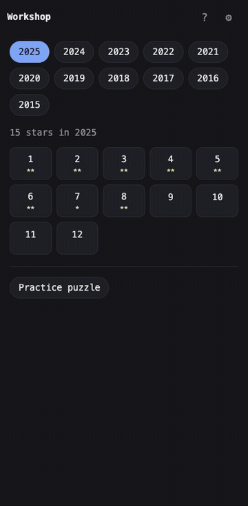

# Dictation

Code can be dictated as well as typed. Hold the button and say the code you want, roughly as you'd type it, and a model turns it into a precise edit at your cursor, which is handy when you're working one-handed, away from a desk.

  

- Edits are relative to the cursor, like "before that" or "wrap that in parens". Misheard words like "fold are" for `foldr` are fixed from context.
- Instant commands like "undo" and "run the sample" skip the model.
- Plans, notes, cards and what you say to the coaches can be dictated too.
- [whisper.cpp](https://github.com/ggml-org/whisper.cpp) (`brew install whisper.cpp` on macOS), if installed, hears code more accurately than your phone's speech recognition.

Dictation is voice editing, not code generation: you dictate the code itself, so "write a function to sort a list" won't do anything. If Workshop isn't sure what you meant, it makes no edit and tells you why.

The model making the edits is chosen under Settings, Models, or `[models.edit]` in your [config](configuration.md). To compare models on the same set of example utterances, use `workshop eval --model codex:luna`, for example.
